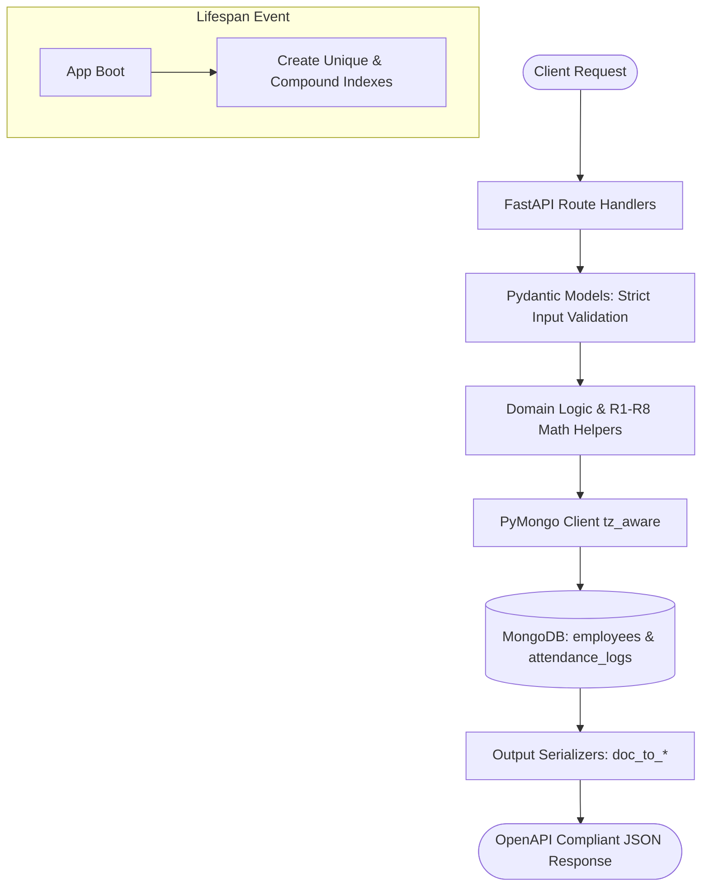
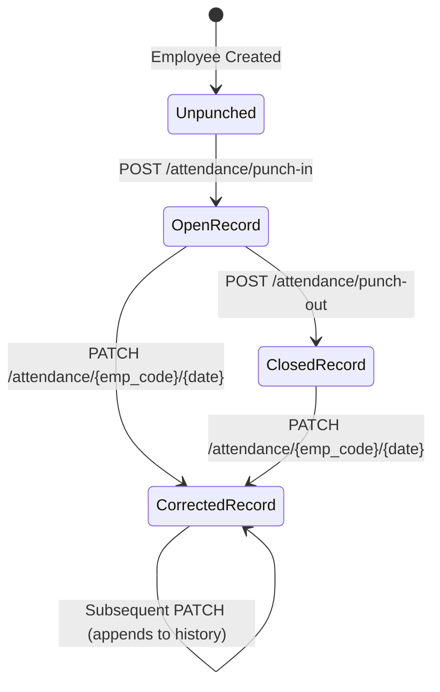

# Project Architecture & Phase 1 & 2 Implementation Details

This document explains the work completed in **Phase 1 (Environment, Lifespan, and Business Logic Utilities)** and **Phase 2 (Starter Code Bug Fixes & Refactoring)** of the Employee Attendance & Analytics API.

---

## 1. High-Level Architecture & Workflow

The application is built on **FastAPI** and **MongoDB**, designed to operate without memory bloat even across 100,000+ attendance records.



### The Boundary Transformation Principle
There is a strict separation between how data is represented over the wire (HTTP API) versus how data is stored on disk (MongoDB):

| Value Kind | HTTP API Representation | MongoDB BSON Storage | Conversion Strategy |
| :--- | :--- | :--- | :--- |
| **Instants** (punches, created_at, audit) | Integer epoch milliseconds (`int`) | BSON Datetime (`datetime` UTC) | Truncated to seconds (`// 1000 * 1000`), converted to UTC BSON datetime on write; transformed to epoch ms on read. |
| **Calendar Dates** | String `"YYYY-MM-DD"` (IST) | String `"YYYY-MM-DD"` | Plain strings on purpose so no implicit time zone conversion is forced. |
| **Shift Times** | String `"HH:MM"` (IST 24-hr) | String `"HH:MM"` | Plain string representations (e.g., `"09:30"`, `"18:30"`, `"22:00"`). |
| **Document Identity** | `emp_code` (business key) | `_id` (internal ObjectId) | `_id` is stripped from all responses. No `id` field is ever exposed. |

---

## 2. Phase 1: Core Utilities & Business Rules (R1 – R8)

### Rule R1: Timezone, Instants Truncation & Overnight Shifts
* **Timezone**: All shift times and attendance dates operate under **Indian Standard Time (IST, UTC+05:30)**.
* **Instant Truncation**: Instants are truncated to whole seconds *before* any calculation, and this truncated value is what gets stored:
  $$\text{truncated\_ms} = \left(\frac{\text{raw\_ms}}{1000}\right) \times 1000$$
* **Overnight Shift Calendar Date**:
  When an employee's shift ends on or before it starts (`shift_end <= shift_start`, e.g., `22:00` to `06:00`), any punch-in whose IST time of day is **strictly earlier than `shift_end`** belongs to the shift that started on the **previous calendar day**:
  ```python
  def determine_attendance_date(punch_in_ist: datetime, shift_start: str, shift_end: str) -> str:
      is_overnight = shift_end <= shift_start
      if is_overnight:
          h_end, m_end = map(int, shift_end.split(":"))
          if punch_in_ist.time() < time(h_end, m_end):
              return (punch_in_ist.date() - timedelta(days=1)).isoformat()
      return punch_in_ist.date().isoformat()
  ```

---

### Rule R2: Grace Period & Late Calculation
* **Grace Period**: 10 minutes (600 seconds).
* **Late Condition**: Punch-in is late only if strictly $> 10:00$ after `shift_start`.
* **Penalty Calculation**: Once late, `late_minutes = floor(minutes since shift_start)`, **not** minutes since the grace period ended!
  * Example (`09:30` shift):
    * `09:40:00` $\rightarrow$ 600s elapsed $\rightarrow$ **0 late minutes**
    * `09:40:01` $\rightarrow$ 601s elapsed $\rightarrow$ **10 late minutes** (`601 // 60 = 10`)
    * `10:15:59` $\rightarrow$ 2759s elapsed $\rightarrow$ **45 late minutes** (`2759 // 60 = 45`)
  * Overnight shifts construct `shift_start` on the record's attendance date in IST so late calculations remain accurate even when punching in after midnight.

---

### Rule R3: Overtime Calculation
* Overtime is the whole minutes (floor) between `shift_end` and `punch_out`.
* **Minimum Threshold**: Counted only if $\ge 30$ minutes; otherwise returns $0$.
* **Overnight Shifts**: For overnight shifts (`22:00` to `06:00`), `shift_end` falls on `record_date + 1 day` in IST:
  ```python
  if is_overnight:
      shift_end_dt = datetime.combine(record_date + timedelta(days=1), time(h_end, m_end), tzinfo=IST)
  else:
      shift_end_dt = datetime.combine(record_date, time(h_end, m_end), tzinfo=IST)
  ```

---

### Rule R4 & R8: Half-Up Rounding vs. Banker's Rounding
Standard Python `round()` implements **Banker's Rounding** (round half to even). For example, `round(4.125, 2)` gives `4.12`. However, the API contract strictly demands **Half-Up Rounding** (`4.125` $\rightarrow$ `4.13`).

We use Python's `decimal.Decimal` module with `ROUND_HALF_UP`:
```python
def round_half_up(val: float | Decimal, decimals: int = 2) -> float:
    d = Decimal(str(val))
    q = Decimal("10") ** -decimals
    return float(d.quantize(q, rounding=ROUND_HALF_UP))

def compute_work_hours(punch_in_utc: datetime, punch_out_utc: datetime) -> float:
    diff_sec = Decimal(str(int((punch_out_utc - punch_in_utc).total_seconds())))
    hours = diff_sec / Decimal("3600")
    return float(hours.quantize(Decimal("0.01"), rounding=ROUND_HALF_UP))
```

---

### Rule R5: Half-Day Rule
* After punch-out, if the rounded `work_hours < 4.50`, `half_day = True`.
* A half day counts as **0.5 of a present day** in monthly and department analytics.

---

## 3. Phase 2: Starter Code Refactoring & Bug Fixes

The starter application had over 10 defects that prevented race safety, violated the API contract, and caused database-level degradation. Here is how each was addressed:

### 1. Startup Lifecycle & Database Indexes
* **Problem**: The starter had zero indexes created at startup. Queries on 100k records would default to collection scans (`COLLSCAN`), and duplicate checks had race conditions.
* **Solution**: Implemented `@asynccontextmanager` FastAPI lifespan to build indexes idempotently on app launch:
  ```python
  @asynccontextmanager
  async def lifespan(app: FastAPI):
      db.employees.create_index([("emp_code", 1)], unique=True)
      db.employees.create_index([("department", 1), ("joined_on", 1)])
      db.attendance_logs.create_index([("emp_code", 1), ("date", 1)], unique=True)
      db.attendance_logs.create_index([("date", -1), ("emp_code", 1)])
      db.attendance_logs.create_index([("emp_code", 1), ("punch_in", 1)])
      db.attendance_logs.create_index([("status", 1), ("date", 1)])
      yield
  ```

---

### 2. `GET /health` Probe
* **Problem**: Returned hard-coded `{"status": "ok"}` without testing database connectivity.
* **Solution**: Actively pings MongoDB via `client.admin.command('ping')` inside a `try/except` block and returns HTTP 503 if the database is unreachable.

---

### 3. `POST /employees` & Employee Schema
* **Problem**:
  * Vulnerable to race conditions (used `find_one` check followed by `insert_one`).
  * Returned ISO string for `created_at` instead of epoch milliseconds.
  * Missing input validation: accepted invalid employee codes, malformed emails, and identical shift start/end times (`09:00` - `09:00`).
* **Solution**:
  * Relies on the unique database index on `emp_code` and catches `DuplicateKeyError` to return HTTP 409 atomically.
  * Pydantic regex pattern `^EMP\d{4,6}$` and model validator ensuring `shift_start != shift_end`.
  * Serializes `created_at` as integer epoch milliseconds.

---

### 4. `GET /employees` Pagination & Sorting
* **Problem**:
  * Calculated `skip = page * page_size`, which caused `page=1` to skip the first 20 records (off-by-one error).
  * `total` ran `count_documents({})`, returning the total collection size rather than the filtered count.
  * Omitted sorting, returning documents in arbitrary database order.
* **Solution**:
  * Fixed skip formula to `(page - 1) * page_size`.
  * Total counts against the filter query: `db.employees.count_documents(q)`.
  * Added `.sort("emp_code", 1)` to guarantee deterministic ascending order.

---

### 5. `POST /attendance/punch-in` Safety & Formatting
* **Problem**:
  * Raised an unhandled 500 error if employee did not exist (`TypeError` accessing `None["shift_start"]`).
  * Vulnerable to race conditions allowing multiple punch-ins for the same day.
  * Returned an illegal `id` field (`str(res.inserted_id)`).
  * Evaluated timestamps in local system timezone rather than IST.
* **Solution**:
  * Returns HTTP 404 if `emp_code` is not found.
  * Enforces unique compound index `(emp_code, date)` and catches `DuplicateKeyError` to return HTTP 409.
  * Strictly adheres to OpenAPI `AttendanceRecord` schema (no `_id` and no `id`).
  * Validates `punched_at` using strict Pydantic bounds (`100000000000` to `4102444800000`) so seconds or strings trigger HTTP 422.

---

### 6. `GET /attendance` Memory-Safe Pagination & Sort
* **Problem**:
  * Executed `docs = list(db.attendance_logs.find(q))` and sorted in Python. On a 100,000 document collection, this causes high latency and crashes with Out-Of-Memory (OOM).
  * Allowed invalid date ranges (`date_from > date_to`).
  * Only sorted by date reverse, missing secondary sort by `emp_code ASC`.
* **Solution**:
  * Added validation raising HTTP 422 if `date_from > date_to`.
  * Delegates sorting, skipping, and limiting entirely to the MongoDB engine:
    ```python
    cursor = (
        db.attendance_logs.find(q)
        .sort([("date", -1), ("emp_code", 1)])
        .skip((page - 1) * page_size)
        .limit(page_size)
    )
    ```

---

---

## 4. Phase 3: Core Punch-Out & Regularization Workflows

Phase 3 implements the complete lifecycle of attendance logs: closing open records via punch-out and providing an immutable audit trail for manual manager corrections (regularizations).



---

### 1. `POST /attendance/punch-out`
* **Goal**: Closes the employee's most recent record whose `punch_in <= punched_at` (including overnight shifts across midnight).
* **Derived Calculations**:
  * `work_hours`: $(punch\_out - punch\_in) / 3600$, rounded half-up to 2 decimals (R4).
  * `overtime_minutes`: Minutes from `shift_end` to `punch_out`, counted only if $\ge 30$; otherwise 0 (R3). Handles overnight shifts where `shift_end` is on `date + 1 day`.
  * `half_day`: `True` if rounded `work_hours < 4.50`, else `False` (R5).
* **Race-Condition Safety**:
  Two simultaneous punch-outs must yield exactly one 200 and one 409. We achieve this with atomic `find_one_and_update`:
  ```python
  updated_doc = db.attendance_logs.find_one_and_update(
      {
          "_id": target_record["_id"],
          "punch_out": None,   # Guarantees only one concurrent request can succeed
      },
      {
          "$set": {
              "punch_out": punch_out_utc,
              "work_hours": work_hours,
              "overtime_minutes": overtime_min,
              "half_day": half_day,
          }
      },
      return_document=ReturnDocument.AFTER,
  )
  if updated_doc is None:
      raise HTTPException(status_code=409, detail="Record already punched out")
  ```
* **Status Codes**:
  * `200`: Successfully updated record.
  * `404`: Unknown employee, or no punch-in found at or before `punched_at`.
  * `409`: Record is already punched out.
  * `422`: Validation failure (out-of-range timestamp, etc.).

---

### 2. `PATCH /attendance/{emp_code}/{date}` (Regularization)
* **Goal**: Manually correct an attendance day addressed by its natural key `(emp_code, date)`.
* **Business & Validation Rules**:
  1. **ABSENT or LEAVE**: Clears both punch times, sets `work_hours = None`, `late_minutes = 0`, `overtime_minutes = 0`, `half_day = False`. Supplying `punch_in` or `punch_out` when setting ABSENT or LEAVE returns **422**.
  2. **Presence Status**: Requires a `punch_in` (either supplied or already stored).
  3. **Attendance Date Anchor**: `punch_in` must stay on the record's attendance date per R1. If an altered timestamp causes `determine_attendance_date` to shift to a different day, returns **422**.
  4. **Punch-Out Boundary**: `punch_out` must be strictly after `punch_in` and within 24 hours ($diff \le 86400$s). Otherwise returns **422**.
  5. **Zero Changes Check**: A request that changes nothing returns **422**.
  6. **Recomputation**: Automatically recalculates `late_minutes`, `work_hours`, `overtime_minutes`, and `half_day`.
  7. **Audit Trail (`history`)**:
     * Appends exactly one `{at, by, reason, changes}` entry.
     * `changes` records *only* the fields that actually changed (`from` and `to`).
     * `punch_in` and `punch_out` are stored in MongoDB as UTC datetimes, but returned in the API as integer epoch milliseconds.
  8. **Optimistic Concurrency Control**:
     Concurrent regularizations must not silently lose each other's history. The query matches the exact current `history` array. If another request intervened, `find_one_and_update` returns `None` and raises **409**, preserving the winner's audit trail.

---

## 5. Verification & Testing

### Test Coverage Matrix:
| Test Scenario | Tested Endpoint | Expected Behavior | Result |
| :--- | :--- | :--- | :--- |
| MongoDB Connectivity Probe | `GET /health` | 200 on active ping, 503 on DB down | **PASSED** |
| Unique Employee Constraint | `POST /employees` | 201 on create, 409 on duplicate | **PASSED** |
| Shift Mismatch Validation | `POST /employees` | 422 if `shift_start == shift_end` | **PASSED** |
| Deterministic Paging & Sort | `GET /employees` | `(page-1)*size` skip, sorted `emp_code ASC` | **PASSED** |
| Punch-In Overnight Shift | `POST /attendance/punch-in` | Assigns pre-shift-end punches to previous day | **PASSED** |
| Punch-In Duplicate Guard | `POST /attendance/punch-in` | 409 via `(emp_code, date)` unique index | **PASSED** |
| Punch-Out Unknown / No Punch-In | `POST /attendance/punch-out` | 404 Not Found | **PASSED** |
| Punch-Out Math & Overtime | `POST /attendance/punch-out` | 200 with R3 overtime & R4 work hours | **PASSED** |
| Punch-Out Idempotency Guard | `POST /attendance/punch-out` | 409 on already punched-out record | **PASSED** |
| Regularization No-Op | `PATCH /attendance/...` | 422 if nothing changes | **PASSED** |
| Regularization Absent/Leave Conflict | `PATCH /attendance/...` | 422 if punch times supplied | **PASSED** |
| Regularization Audit Trail | `PATCH /attendance/...` | 200 with before/after diffs in `history` | **PASSED** |
| Multi-Correction History Appending | `PATCH /attendance/...` | Preserves all previous audit entries | **PASSED** |

---

## 6. Next Steps (Upcoming Phases)

* **Phase 4**:
  * Build native MongoDB aggregation pipelines:
    1. `GET /analytics/employees/{emp_code}/monthly` (Mon-Fri working days, joiner adjustments, presence rate).
    2. `GET /analytics/departments/summary` (cross-collection aggregation preserving zero-log employees in headcount).
    3. `GET /analytics/leaderboard/late` (standard competition ranking with window functions: 1, 2, 2, 4).
    4. `GET /analytics/departments/{department}/trend` (MongoDB `$densify` gap filling and 7-day rolling window).
* **Phase 5**:
  * Implement `GET /admin/explain/{endpoint}` and verify `IXSCAN` plans without collection scans.
* **Phase 6 & 7**:
  * Complete `DECISIONS.md`, finalize `README.md`, and clean workspace for final submission.

